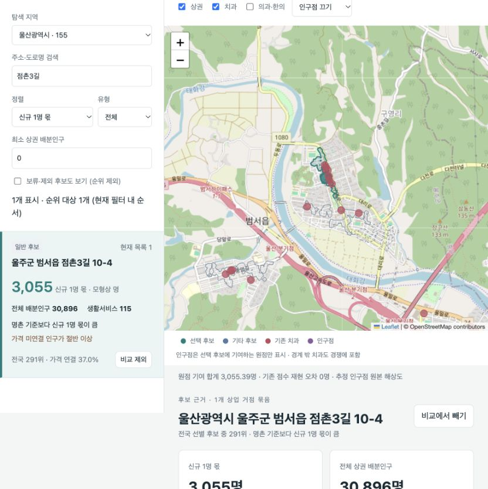

# Dental Location Explorer

If a dentist opens a practice in a particular neighborhood in South Korea, which residents could it serve, and how much local dental capacity is already available? I built this project to compare candidate sites and trace a score back to the neighborhoods that contribute to it. The national explorer combines residential population, commercial activity and the number of dentists at existing practices. Its scores describe modeled access. They do not predict patient visits or revenue.



In this Ulsan example, about 3,055 resident-equivalents are attributed to a practice with one incoming dentist. Selecting a site shows where that estimate comes from. Basemap © [OpenStreetMap contributors](https://www.openstreetmap.org/copyright).

## Try the offline demos

Clone the repository and run these commands from its root. Both demos use Python 3.9 or later and its standard library. All input records in the demos are synthetic.

```sh
git clone https://github.com/yhryu0409/dental-location-explorer.git
cd dental-location-explorer
python3 tools/run_population_demand_demo.py
python3 tools/run_m1_gate.py
```

**Explore a regional demand scenario.** The first command prints the path to `report.html`. Open it in a browser. It contains three fictional markets and 14,000 residents distributed across six residential cells. Search for `demo_hub`, select its row, and switch the attraction setting from **없음** (off) to **강함** (strong). The restaurant district's allocation rises from about 3,200 to 4,700 resident-equivalents. The original population stays at 14,000. The adjacent `bundle.json` contains the full-precision results, assumptions and input checksums.

**Exercise the data pipeline.** The second command prints `"passed": true` when all six checks succeed. It collects six sample facility records, produces an analytical table, reruns the same input, and rebuilds the result from raw pages. It also verifies collection history, simulates an upstream error and interrupts publication to check that readers can still access the last successful release.

The **national map** pictured above uses a separate research snapshot. The public repository includes its server, interface, and fixture-based tests. National source records and precomputed matrices are stored separately. [Explorer setup and data requirements](tools/location_explorer/README.md)

## Two engineering decisions

- **What should readers see when a refresh fails halfway through?** The pipeline stores the original response pages before parsing and records their checksums. A new release becomes current only after validation and a metadata commit. The failure tests check the release pointer and collection watermark together, so a retry starts from the last successful state. [Pipeline](src/dental_market/pipeline.py) · [Release handling](src/dental_market/release.py)
- **What does it mean to compare two candidate sites?** The national model estimates what would happen if a practice opened at each site independently. Two candidates may draw from the same neighborhood, so adding their scores would count some of the same demand twice. In the regional demo, residents are allocated among the modeled markets and an outside option. Each scenario must account for the same source population across all age groups. [National model](tools/location_explorer/server.py) · [Regional calculation and tests](tests/test_population_demand_mvp.py)

## Run the tests

```sh
python3 -m pip install -r requirements-test.lock
python3 -m pytest -q
```

The core suite covers collection, replay, release rollback, population conservation and report generation. The [explorer tests](tools/location_explorer/README.md) also exercise the geographic calculations and browser-side scenario controls. [GitHub Actions](https://github.com/yhryu0409/dental-location-explorer/actions) runs the demos and both test suites on a fresh Linux runner.
