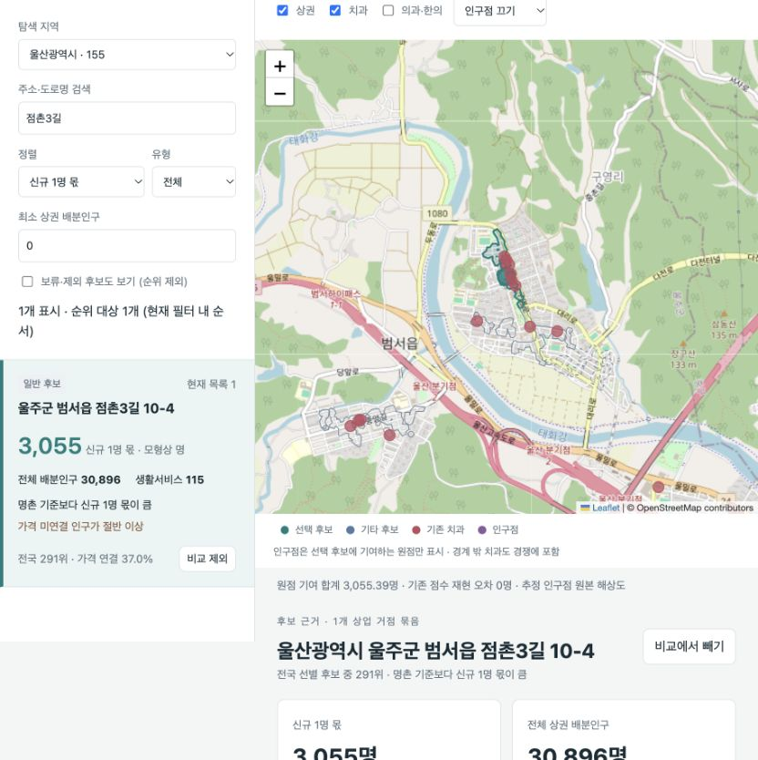

# Nationwide location explorer

The explorer maps candidate sites in South Korea. Select a site to see which neighborhoods contribute to its modeled demand, compare one- and three-dentist scenarios, and inspect how nearby practices affect each estimate. The map uses Korean place names and labels.



The screenshot shows one candidate in Ulsan. Counts express resident-equivalents under the selected scenario. Basemap © [OpenStreetMap contributors](https://www.openstreetmap.org/copyright).

## Run the offline checks

From the repository root, install the optional geographic analysis dependencies in a virtual environment with Python 3.10 or 3.11. The browser calculation and interface tests use Node.js 20.

```sh
python3 -m pip install -r tools/location_explorer/requirements.txt
python3 -m unittest discover -s tools/location_explorer -p 'test_*.py'
node --test tools/location_explorer/test_*.js
```

The fixture-based tests check that a team shares the available demand, overlapping catchments retain a stable representative, and each origin's full population is accounted for after redistribution. An observed zero and an unavailable observation stay distinct. Integration tests of archived national observations skip when the corresponding snapshot is absent.

## Run with a research snapshot

The [repository quick start](../../README.md) produces a synthetic regional report from a clean checkout. Running the nationwide server also requires the privately stored research snapshot. The expected directory tree contains the base release pointer at `research/refresh_20261013/latest.json`, its pinned inputs and sparse matrices, and the precomputed regional strategy releases. Optional comparison views read their corresponding research releases.

```sh
export DENTAL_EXPLORER_DATA_ROOT=/path/to/snapshot-root
python3 tools/location_explorer/server.py --port 8877
```

Open `http://127.0.0.1:8877` for the candidate map and `/strategy.html` for the local and growth scenarios. Basemap tiles and the Leaflet client load over the internet. Candidate records, scenario results, and provenance come from the local server. Each candidate is evaluated in a separate entry scenario.
